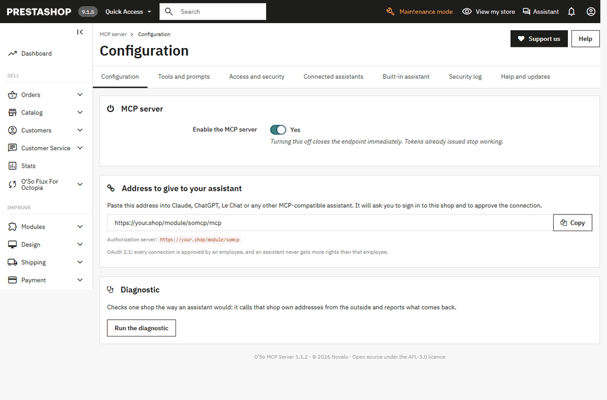

# PrestaShop MCP Server

[](https://prestashop.com)
[](https://php.net)
[](https://modelcontextprotocol.io)

[](LICENSE.txt)
[](https://github.com/novalo-dev/Prestashop-MCP-Server/wiki)

[](CONTRIBUTING.md)
[](https://github.com/novalo-dev/Prestashop-MCP-Server/stargazers)
[](https://github.com/novalo-dev/Prestashop-MCP-Server/forks)
[](https://github.com/novalo-dev/Prestashop-MCP-Server/graphs/contributors)

A PrestaShop module that turns a shop into an [MCP](https://modelcontextprotocol.io)
server. Claude, ChatGPT, Le Chat or any MCP-compatible assistant
([full list](#compatible-assistants)) can then work with the shop's orders
and catalogue, through a standard protocol, with OAuth 2.1 and the employee's
own back office permissions, instead of a database login or an API key that can
do everything.

The module folder is `somcp`; in the back office it is called **O'So MCP Server**.

The module documentation - requirements, installation, configuration and how
to connect each assistant - is on the [wiki](https://github.com/novalo-dev/Prestashop-MCP-Server/wiki).

https://github.com/user-attachments/assets/cf0b0e3f-1172-4ba9-aad1-11a6298aadf7

This repository is looking for PrestaShop developers who want to build it with
us. See [Where to help](#where-to-help).

---

## What it does

- **Serves MCP from inside PrestaShop.** No separate service, no Node process.
  The endpoint is a module front controller.
- **Runs its own OAuth 2.1 authorization server**: discovery documents (RFC 9728
  and RFC 8414), PKCE S256, dynamic client registration and client ID metadata
  documents, refresh token rotation with reuse detection. Tokens are stored
  hashed and bound to the shop they were issued for.
- **Uses PrestaShop permissions as they are.** An employee connects an assistant
  on their own behalf, on a consent screen in the back office. The assistant
  then holds exactly that employee's rights: each tool is tied to a back office
  page and one of the four rights PrestaShop already manages, `view`, `add`,
  `edit` or `delete`.
- **Supports multistore natively.** Each shop has its own address, its own
  tokens and its own settings with the usual inheritance. An employee only
  reaches the shops they are attached to.
- **Lets any module publish tools and prompts** through two hooks, by returning
  arrays. No dependency on somcp's classes, so those modules still pass the
  Addons validator. See [docs/EXTENDING.md](docs/EXTENDING.md).
- **Has a built-in assistant in the back office.** A chat button at the top
  right of every page opens a conversation with the AI the merchant connected
  with their own API key: [Claude](https://console.anthropic.com/settings/keys),
  [ChatGPT](https://platform.openai.com/api-keys),
  [Gemini](https://aistudio.google.com/apikey),
  [Mistral](https://console.mistral.ai/api-keys),
  [DeepSeek](https://platform.deepseek.com/api_keys),
  [Grok](https://console.x.ai) or
  [Cohere](https://dashboard.cohere.com/api-keys) - each link opens the page
  where that provider gives out keys - or with an AI running on the merchant's
  own computer, such as Ollama or LM Studio, linked through
  [somcp-relay](https://github.com/novalo-dev/Somcp-Relay) with no key and
  nothing opened on their network. It uses the same tools, with the rights of the employee
  signed in, and asks for approval before any change. Several assistants can
  share the work by role. Each conversation can switch on deep thinking
  (Claude, Gemini, OpenAI's reasoning models) and web search (Claude and
  Gemini on their own, the others through one of them), and switch the
  memory off, from the **+** menu. It knows the module it belongs to, and
  for super administrators reads and, after approval, changes its settings.
  Runs on [Neuron AI](https://github.com/neuron-core/neuron-ai).
- **Speaks both eras of the protocol** from one endpoint: the stateless
  `2026-07-28` revision, with questions in the middle of a call, and the
  `2025-11-25`, `2025-06-18` and `2025-03-26` revisions.

## Screenshots

The settings pages on PrestaShop 9.1, one after the other: configuration, tools
and prompts, access and security, connected assistants, built-in assistant,
security log, help and updates, and the chat.



## Compatibility

| | |
|---|---|
| PrestaShop | 8.0.0 to 9.x (`ps_versions_compliancy` 8.0.0 - 9.99.99) |
| PHP | 8.1 or later |
| Multistore | supported |
| Languages | English, French, Spanish, German |

The shop has to be reachable over **HTTPS**, with **friendly URLs** enabled, and
installed at the **root of its domain**: OAuth anchors one of its discovery
documents there. The diagnostic button in the settings checks the certificate,
the SSL setting, the friendly URLs, the location and the addresses an assistant
calls, from the outside. The full
list of requirements is on the
[wiki](https://github.com/novalo-dev/Prestashop-MCP-Server/wiki#requirements).

## Tools

Grouped by back office page, each object's reads before its writes. A new tool goes in the table of its page.

### Connection

| Tool | Scope | Back office right | Nature |
|---|---|---|---|
| `somcp_ping` | `mcp.access` | none | read |

### Orders

| Tool | Scope | Back office right | Nature |
|---|---|---|---|
| `somcp_search_orders` | `mcp.orders.read` | `view` on `AdminOrders` | read |
| `somcp_get_order` | `mcp.orders.read` | `view` on `AdminOrders` | read |
| `somcp_list_order_statuses` | `mcp.orders.read` | `view` on `AdminStatuses` | read |
| `somcp_list_return_statuses` | `mcp.orders.read` | `view` on `AdminStatuses` | read |
| `somcp_list_carriers` | `mcp.orders.read` | `view` on `AdminCarriers` | read |
| `somcp_set_order_status` | `mcp.orders.write` | `edit` on `AdminOrders` | write |
| `somcp_set_order_tracking` | `mcp.orders.write` | `edit` on `AdminOrders` | write |
| `somcp_add_order_message` | `mcp.orders.write` | `edit` on `AdminOrders` | write |
| `somcp_set_order_note` | `mcp.orders.write` | `edit` on `AdminOrders` | write |
| `somcp_add_order_payment` | `mcp.orders.write` | `edit` on `AdminOrders` | write |
| `somcp_create_return_status` | `mcp.orders.write` | `add` on `AdminStatuses` | write |
| `somcp_update_return_status` | `mcp.orders.write` | `edit` on `AdminStatuses` | write |
| `somcp_create_order_status` | `mcp.orders.write` | `add` on `AdminStatuses` | write |

### Catalog - Products

| Tool | Scope | Back office right | Nature |
|---|---|---|---|
| `somcp_search_products` | `mcp.catalog.read` | `view` on `AdminProducts` | read |
| `somcp_get_product` | `mcp.catalog.read` | `view` on `AdminProducts` | read |
| `somcp_create_product` | `mcp.catalog.write` | `add` on `AdminProducts` | write |
| `somcp_update_product` | `mcp.catalog.write` | `edit` on `AdminProducts` | write |
| `somcp_set_product_active` | `mcp.catalog.write` | `edit` on `AdminProducts` | write |
| `somcp_delete_product` | `mcp.catalog.write` | `delete` on `AdminProducts` | write |

### Catalog - Categories

| Tool | Scope | Back office right | Nature |
|---|---|---|---|
| `somcp_list_categories` | `mcp.catalog.read` | `view` on `AdminCategories` | read |
| `somcp_get_category` | `mcp.catalog.read` | `view` on `AdminCategories` | read |
| `somcp_create_category` | `mcp.catalog.write` | `add` on `AdminCategories` | write |
| `somcp_update_category` | `mcp.catalog.write` | `edit` on `AdminCategories` | write |
| `somcp_set_category_active` | `mcp.catalog.write` | `edit` on `AdminCategories` | write |

### Catalog - Brands

| Tool | Scope | Back office right | Nature |
|---|---|---|---|
| `somcp_list_manufacturers` | `mcp.catalog.read` | `view` on `AdminManufacturers` | read |
| `somcp_get_manufacturer` | `mcp.catalog.read` | `view` on `AdminManufacturers` | read |
| `somcp_create_manufacturer` | `mcp.catalog.write` | `add` on `AdminManufacturers` | write |
| `somcp_update_manufacturer` | `mcp.catalog.write` | `edit` on `AdminManufacturers` | write |
| `somcp_set_manufacturer_active` | `mcp.catalog.write` | `edit` on `AdminManufacturers` | write |
| `somcp_list_manufacturer_addresses` | `mcp.catalog.read` | `view` on `AdminManufacturers` | read |
| `somcp_get_manufacturer_address` | `mcp.catalog.read` | `view` on `AdminManufacturers` | read |
| `somcp_create_manufacturer_address` | `mcp.catalog.write` | `edit` on `AdminManufacturers` | write |
| `somcp_update_manufacturer_address` | `mcp.catalog.write` | `edit` on `AdminManufacturers` | write |
| `somcp_delete_manufacturer_address` | `mcp.catalog.write` | `delete` on `AdminManufacturers` | write |

### Catalog - Suppliers

| Tool | Scope | Back office right | Nature |
|---|---|---|---|
| `somcp_list_suppliers` | `mcp.catalog.read` | `view` on `AdminSuppliers` | read |
| `somcp_get_supplier` | `mcp.catalog.read` | `view` on `AdminSuppliers` | read |
| `somcp_create_supplier` | `mcp.catalog.write` | `add` on `AdminSuppliers` | write |
| `somcp_update_supplier` | `mcp.catalog.write` | `edit` on `AdminSuppliers` | write |
| `somcp_set_supplier_active` | `mcp.catalog.write` | `edit` on `AdminSuppliers` | write |

### Catalog - Attributes

| Tool | Scope | Back office right | Nature |
|---|---|---|---|
| `somcp_list_attributes` | `mcp.catalog.read` | `view` on `AdminAttributesGroups` | read |
| `somcp_get_attribute_group` | `mcp.catalog.read` | `view` on `AdminAttributesGroups` | read |
| `somcp_create_attribute_group` | `mcp.catalog.write` | `add` on `AdminAttributesGroups` | write |
| `somcp_update_attribute_group` | `mcp.catalog.write` | `edit` on `AdminAttributesGroups` | write |
| `somcp_get_attribute_value` | `mcp.catalog.read` | `view` on `AdminAttributesGroups` | read |
| `somcp_create_attribute_value` | `mcp.catalog.write` | `add` on `AdminAttributesGroups` | write |
| `somcp_update_attribute_value` | `mcp.catalog.write` | `edit` on `AdminAttributesGroups` | write |

### Catalog - Features

| Tool | Scope | Back office right | Nature |
|---|---|---|---|
| `somcp_list_features` | `mcp.catalog.read` | `view` on `AdminFeatures` | read |
| `somcp_get_feature` | `mcp.catalog.read` | `view` on `AdminFeatures` | read |
| `somcp_create_feature` | `mcp.catalog.write` | `add` on `AdminFeatures` | write |
| `somcp_update_feature` | `mcp.catalog.write` | `edit` on `AdminFeatures` | write |
| `somcp_get_feature_value` | `mcp.catalog.read` | `view` on `AdminFeatures` | read |
| `somcp_create_feature_value` | `mcp.catalog.write` | `add` on `AdminFeatures` | write |
| `somcp_update_feature_value` | `mcp.catalog.write` | `edit` on `AdminFeatures` | write |

### Catalog - Files and taxes

| Tool | Scope | Back office right | Nature |
|---|---|---|---|
| `somcp_list_attachments` | `mcp.catalog.read` | `view` on `AdminAttachments` | read |
| `somcp_list_tax_rules` | `mcp.catalog.read` | `view` on `AdminTaxRulesGroup` | read |

### Stock

| Tool | Scope | Back office right | Nature |
|---|---|---|---|
| `somcp_get_stock` | `mcp.stock.read` | `view` on `AdminStockManagement` | read |
| `somcp_list_low_stock` | `mcp.stock.read` | `view` on `AdminStockManagement` | read |
| `somcp_set_stock_quantity` | `mcp.stock.write` | `edit` on `AdminStockManagement` | write |

### Customers

| Tool | Scope | Back office right | Nature |
|---|---|---|---|
| `somcp_search_customers` | `mcp.customers.read` | `view` on `AdminCustomers` | read |
| `somcp_get_customer` | `mcp.customers.read` | `view` on `AdminCustomers` | read |
| `somcp_create_customer` | `mcp.customers.write` | `add` on `AdminCustomers` | write |
| `somcp_update_customer` | `mcp.customers.write` | `edit` on `AdminCustomers` | write |

### Statistics

| Tool | Scope | Back office right | Nature |
|---|---|---|---|
| `somcp_get_sales_summary` | `mcp.stats.read` | `view` on `AdminStats` | read |
| `somcp_list_best_sellers` | `mcp.stats.read` | `view` on `AdminStats` | read |

### Content

| Tool | Scope | Back office right | Nature |
|---|---|---|---|
| `somcp_list_cms_pages` | `mcp.content.read` | `view` on `AdminCmsContent` | read |

### SEO

| Tool | Scope | Back office right | Nature |
|---|---|---|---|
| `somcp_get_seo_settings` | `mcp.seo.read` | `view` on `AdminMeta` | read |
| `somcp_list_meta_pages` | `mcp.seo.read` | `view` on `AdminMeta` | read |
| `somcp_audit_page` | `mcp.seo.read` | `view` on `AdminMeta` | read |
| `somcp_audit_product_seo` | `mcp.seo.read` | `view` on `AdminProducts` | read |
| `somcp_audit_category_seo` | `mcp.seo.read` | `view` on `AdminCategories` | read |
| `somcp_audit_cms_seo` | `mcp.seo.read` | `view` on `AdminCmsContent` | read |
| `somcp_audit_brand_seo` | `mcp.seo.read` | `view` on `AdminManufacturers` | read |
| `somcp_update_cms_seo` | `mcp.seo.write` | `edit` on `AdminCmsContent` | write |
| `somcp_get_robots_txt` | `mcp.seo.read` | `view` on `AdminMeta` | read |
| `somcp_generate_robots_txt` | `mcp.seo.write` | `add`, `edit` and `delete` on `AdminMeta` | write |

**Reads** are flagged read-only and safe to repeat. **Writes** are flagged
destructive, which is what MCP clients use to ask the merchant before running
them; each write changes one object per call and is never retried on a lost
answer.

`somcp_ping` is outside the permission system on purpose: it reads no shop data
and only says what the assistant is connected to (shop, account, language,
currency), so an assistant can always tell which account it is using, even one
with no rights at all.

Nine prompts ship with the module: checking the connection, finding an order,
changing an order status, managing products, checking stock, finding a customer,
auditing SEO, reporting sales, and reading content pages. The built-in assistant
offers them too, each with its icon: those of the back office page open first, and
any of them from the + of its field. Details of every tool are in
[docs/TOOLS.md](docs/TOOLS.md).

## Install for development

1. Clone the repository into your shop's `modules` folder, **as `somcp`**:

   ```bash
   cd /path/to/prestashop/modules
   git clone https://github.com/novalo-dev/Prestashop-MCP-Server.git somcp
   ```

2. Install the module's dependencies, then install it from **Modules > Module
   Manager** and open its settings:

   ```bash
   cd somcp && composer install --no-dev
   ```

3. Copy the **address to give to your assistant**. It looks like
   `https://your-shop.example/module/somcp/mcp`.
4. Press **Run the diagnostic**. No line should be red before you connect an
   assistant; a warning, such as a shop in maintenance, does not stop it.

A local shop needs a public HTTPS address for an MCP client to reach it: use a
tunnel such as `cloudflared` or `ngrok` and set the shop's domain to it.

Versions are the releases published on GitHub. Between two releases, `main` may
change the database schema; the upgrade for existing shops is written when the
next release is published, so on a development shop, reinstall the module when a
pull request says its schema changed.

## Compatible assistants

Any assistant that connects to a remote MCP server over HTTP with OAuth uses
the shop's MCP address, shown on the module's configuration page. The ones
below can. Where to paste the address in each of them:
[Connect an assistant](https://github.com/novalo-dev/Prestashop-MCP-Server/wiki/Connect-an-assistant).

- **Chat:** [Claude](https://claude.ai) (web, desktop, mobile),
  [ChatGPT](https://chatgpt.com), [Le Chat](https://chat.mistral.ai) (Mistral),
  [Dust](https://dust.tt)
- **Command line:** [Claude Code](https://claude.com/product/claude-code),
  [Codex](https://openai.com/codex/) (OpenAI),
  [Gemini CLI](https://geminicli.com) (Google),
  [GitHub Copilot CLI](https://github.com/features/copilot/cli)
- **Code editor:** [Cursor](https://cursor.com),
  [VS Code](https://code.visualstudio.com) (GitHub Copilot),
  [Windsurf](https://devin.ai/desktop) (Devin Desktop), [Zed](https://zed.dev)
- **Automation:** [n8n](https://n8n.io) (Cloud and self-hosted),
  [Make](https://www.make.com)

## Security model

- **OAuth 2.1 with PKCE (S256 only).** Authorization codes live 60 seconds,
  access tokens one hour and refresh tokens thirty days by default, both
  configurable. Refresh tokens rotate; presenting an old one revokes the grant.
- **Scopes** say what an assistant may do: `mcp.access` to connect,
  `mcp.orders.read`, `mcp.orders.write`, `mcp.catalog.read`, `mcp.catalog.write`,
  `mcp.stock.read`, `mcp.stock.write`, `mcp.customers.read`, `mcp.customers.write`,
  `mcp.seo.read`, `mcp.seo.write`, `mcp.stats.read`, `mcp.content.read`. Other
  modules
  declare their own scopes rather than borrowing these.
- **Back office rights** are checked on every call, against the employee's
  current profile, and the shop always comes from the token, never from the
  request.
- **Redirect URIs** must be `https`, or `http` on loopback. The merchant can
  restrict them to a list of hosts, and restrict which profile may grant
  access.
- **Every connection can be withdrawn** from the settings, and every refusal is
  written to a security log that never contains a token or a secret.

Found a vulnerability? Please do not open an issue: see [SECURITY.md](SECURITY.md).

## Documentation

- [Wiki](https://github.com/novalo-dev/Prestashop-MCP-Server/wiki): the module
  documentation for merchants - requirements, installation, configuration,
  connecting an assistant and the built-in assistant.
- [docs/ARCHITECTURE.md](docs/ARCHITECTURE.md): how a request travels through
  the module, OAuth, MCP, multistore, data.
- [docs/EXTENDING.md](docs/EXTENDING.md): publish tools and prompts from your
  own module, with a complete [example module](docs/example/mymodule).
- [docs/TOOLS.md](docs/TOOLS.md): the conventions every tool follows, and each
  tool in detail.
- [CHANGELOG.md](CHANGELOG.md): what each release changed, and what waits
  under Unreleased for the next one.

## Where to help

The protocol layer, OAuth and permissions are in place. What the module needs
now is reach: more of PrestaShop exposed as tools, more clients tested, more
languages. [ROADMAP.md](ROADMAP.md) lists concrete pieces of work, and
[CONTRIBUTING.md](CONTRIBUTING.md) explains how to set up, what a pull request
needs, and which contributions fit.

## Contributors

Everyone who helped build the module, the top contributor first. The pictures
come straight from GitHub and follow each profile; the shares of the commits
are refreshed at each release. The settings page of the module shows the same list, read from
GitHub, under **Help and updates > Meet our contributors**.

<table>
  <tr>
    <td align="center" width="140">
      <a href="https://github.com/novalo-dev"><br><b>novalo-dev</b></a><br>
      <sub>261 contributions · 84%</sub><br>
      <sub><i>Top contributor</i></sub>
    </td>
    <td align="center" width="140">
      <a href="https://github.com/Ptraaah"><br><b>Ptraaah</b></a><br>
      <sub>50 contributions · 16%</sub>
    </td>
  </tr>
</table>

Want to be next? [CONTRIBUTING.md](CONTRIBUTING.md) explains how.

## License

[Academic Free License 3.0](LICENSE.txt), like the rest of the Novalo modules.
