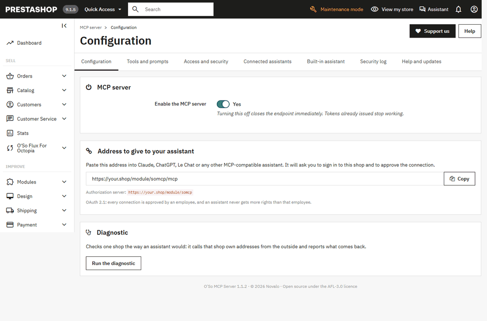

# O'So MCP Server for PrestaShop

<div align="center">

[](https://github.com/novalo-dev/Prestashop-MCP-Server/actions/workflows/php.yml)
[](https://github.com/novalo-dev/Prestashop-MCP-Server/actions/workflows/integration.yml)
[](https://github.com/novalo-dev/Prestashop-MCP-Server/actions/workflows/security.yml)
[](https://github.com/novalo-dev/Prestashop-MCP-Server/actions/workflows/ui.yml)

[](https://github.com/novalo-dev/Prestashop-MCP-Server/releases/latest)
[](https://prestashop.com)
[](https://php.net)
[](https://modelcontextprotocol.io)

[](LICENSE.txt)
[](https://github.com/novalo-dev/Prestashop-MCP-Server/wiki)

**Talk to your PrestaShop shop from Claude, ChatGPT or the assistant built into your back office.**

Free and open source - PrestaShop 8.0 to 9.x - English, French, Spanish, German

[**Download the latest version**](https://github.com/novalo-dev/Prestashop-MCP-Server/releases/latest) · [Documentation](https://github.com/novalo-dev/Prestashop-MCP-Server/wiki) · [Ask a question](https://github.com/novalo-dev/Prestashop-MCP-Server/issues)

</div>

https://github.com/user-attachments/assets/cf0b0e3f-1172-4ba9-aad1-11a6298aadf7

Ask your AI assistant to find an order, change a status, check your stock or
audit a product page, and it does it in your back office - with the rights of
the employee who connected it, and never more.

In the back office the module is called **O'So MCP Server**.

---

## News

**Compact mode comes to O'So MCP Server.** Inspired by the MCP servers of
[Cloudflare](https://blog.cloudflare.com/code-mode-mcp/) and
[Azure](https://learn.microsoft.com/azure/developer/azure-mcp-server/concepts),
which put thousands of operations within an assistant's reach without listing
them all: connected assistants receive four tools instead of more than a
hundred, search the one they need, then run it - with the same permissions and
the same checks. [Compact mode](#compact-mode).

---

## What you can ask

> "Which orders are still waiting for shipment since Monday?"

> "Mark order #1042 as shipped."

> "Which products are almost out of stock?"

> "Show me last month's sales."

> "Audit the SEO of my best-selling product and fix its meta description."

> "Who is the customer behind order #1042, and what else did they buy?"

More than 90 tools cover orders, catalogue, stock, customers, statistics, SEO,
content pages, modules and appearance, and more than 10 ready-made prompts guide
the assistant through the usual jobs. [See them all](#tools).

---

## Requirements

|||
|---|---|
| PrestaShop | 8.0 to 9.x |
| PHP | 8.1 or later, with the cURL extension |
| Address | the shop reachable from the internet over **HTTPS**, so online assistants can connect to it |
| Friendly URLs | enabled (**Shop Parameters > Traffic & SEO**) |
| Location | the shop enabled, and installed at the root of a domain or subdomain, not in a subfolder |
| Multistore | supported: each shop has its own address and settings |
| Languages | English, French, Spanish, German |

The **Run the diagnostic** button in the module checks all of this from the
outside: certificate, SSL setting, friendly URLs, location, the addresses an
assistant calls and the sign-in page where you approve it. No line should be red
before you connect an assistant.

---

## Install

1. **Download** `OSo-MCP-Server-x.y.z.zip` from the
   [latest release](https://github.com/novalo-dev/Prestashop-MCP-Server/releases/latest).
   Do not unzip it.
2. In your back office, open **Modules > Module Manager**, click
   **Upload a module** and drop the zip, then **Configure**.

Then use it either way, or both:
[connect Claude, ChatGPT or another assistant](#1-mcp-server-claude-chatgpt-and-other-assistants)
over MCP, or [open the chat built into your back office](#2-the-chat-built-into-your-back-office).

**With Composer**, on PrestaShop 9, for agencies and automated deployments,
from the shop's root folder:

```
composer config allow-plugins.composer/installers true
composer require novalo/prestashop-mcp-server
php bin/console prestashop:module install somcp
```

The module lands in `modules/somcp`, as with the zip, and its dependencies join
the shop's own `vendor/`. On PrestaShop 8, use the zip: some packages of its
core declare PHP 8.0 at most, and the module needs 8.1, so Composer refuses to
install them together.

---

## 1. MCP server: Claude, ChatGPT and other assistants

Your shop becomes a remote MCP server: an assistant you already use connects
to it and works with [the shop's tools](#tools).

### Connect an assistant

1. In the **Access and security** tab, turn on **Consent page** - it is off
   unless you are connecting an assistant.
2. Copy **the address to give to your assistant** - it looks like
   `https://your-shop.example/module/somcp/mcp` - and paste it into Claude,
   ChatGPT or another assistant
   ([where to paste it](https://github.com/novalo-dev/Prestashop-MCP-Server/wiki/Connect-an-assistant)).

The first time, the assistant opens a page of your shop: you sign in with your
back office email and password, type the code e-mailed to you, check where the
answer goes, and approve what it may do. Then turn **Consent page** off again:
the assistant keeps working. Step by step with screenshots:
[Installation](https://github.com/novalo-dev/Prestashop-MCP-Server/wiki/Installation).

### Compatible assistants

Any assistant that connects to a remote MCP server with OAuth can use your
shop's address. These can:

- **Chat:** [Claude](https://claude.ai) (web, desktop, mobile),
  [ChatGPT](https://chatgpt.com), [Le Chat](https://chat.mistral.ai) (Mistral),
  [Dust](https://dust.tt)
- **Command line:** [Claude Code](https://claude.com/product/claude-code),
  [Codex](https://openai.com/codex/) (OpenAI),
  [Gemini CLI](https://geminicli.com) (Google),
  [GitHub Copilot CLI](https://github.com/features/copilot/cli)
- **Code editor:** [Cursor](https://cursor.com),
  [VS Code](https://code.visualstudio.com) (GitHub Copilot),
  [Windsurf](https://devin.ai/desktop) (Devin Desktop), [Zed](https://zed.dev)
- **Automation:** [n8n](https://n8n.io) (Cloud and self-hosted),
  [Make](https://www.make.com)

Where to paste the address in each of them:
[Connect an assistant](https://github.com/novalo-dev/Prestashop-MCP-Server/wiki/Connect-an-assistant).

### Compact mode

More than a hundred tools weigh on every request an assistant makes, and some
clients cap the count: VS Code stops at 128. In compact mode, connected
assistants receive four tools instead of the whole list:

| Tool | What it does |
|---|---|
| `somcp_ping` | ● Test the connection |
| `somcp_search_tools` | ● Search the shop tools, and give their parameters |
| `somcp_run_read_tool` | ● Run a tool that only reads |
| `somcp_run_write_tool` | ✎ Run a tool that changes the shop, flagged so assistants ask you first |

Nothing else changes: the same permissions, the same switches, the same checks
on every call. A tool the search does not offer cannot be run either. The guides
(prompts) tell the assistant which runner each of their tools goes through.

Turn it on or off in **Tools and prompts › Settings › Compact list of tools**:
on by default for a new shop, off for a shop that updates. The shop cannot
tell a connected assistant that its list changed. One on the latest version of
the protocol reads it again once its copy expires (**How long an assistant
keeps the list of tools**, five minutes by default); the others, ChatGPT among
them today, keep theirs until you refresh their tools in their own settings.
The built-in assistant is not concerned: it already searches its tools itself.

---

## 2. The chat built into your back office

No account to connect: a chat button at the top of every back office page opens
an assistant that works with the same tools, with the rights of the employee
signed in, and asks for your approval before any change.

- Bring your own key from [Claude](https://console.anthropic.com/settings/keys),
  [ChatGPT](https://platform.openai.com/api-keys),
  [Gemini](https://aistudio.google.com/apikey),
  [Mistral](https://console.mistral.ai/api-keys),
  [DeepSeek](https://platform.deepseek.com/api_keys),
  [Grok](https://console.x.ai) or
  [Cohere](https://dashboard.cohere.com/api-keys) - each link opens the page
  where that provider gives out keys.
- Or run an AI on your own computer, such as Ollama or LM Studio, with
  [O'So AI Relay](https://github.com/novalo-dev/Somcp-Relay): no key, and
  nothing opened on your network.

### Switches of each conversation

Set from the **+** menu of the chat, for each conversation.

| Switch | What it does | Needs |
|---|---|---|
| **Deep thinking** | The assistant thinks the request through before it answers: slower, for an audit, a plan or a tricky order | a model that can think: Claude 3.7 and later, Gemini 2.5 and later, OpenAI's reasoning models |
| **Web search** | The assistant looks things up on the web when the shop's data does not answer, and names its sources | Claude or Gemini, or another assistant lending one of them |
| **Memory** | The assistant keeps what matters from one conversation to the next | memory switched on in the module's settings |

### A team of agents, each with its role

Switch on several assistants and give each a **Role**: they work as a team.
The **Default** one leads the conversation and hands each agent the work of
its role, then brings their answers back into the chat.

- **One agent per job**: for example Claude for orders and customers, Mistral
  for SEO and product pages, Gemini or ChatGPT at the **Images** level to
  create product photos.
- **Product photos**: the image agent creates the picture, the chat shows it,
  and the lead agent can add it to the product page once you approve.
- **Safe by design**: an agent sees only the task it was handed - not the
  conversation, not the shop's tools. Every change to the shop goes through
  the lead agent and waits for your approval.

The lead agent hands out the work with `somcp_ask_assistant`, one of the
[tools of the chat only](#tools-of-the-chat-only).

### Tools of the chat only

Besides [the shop's tools](#tools), the chat has these of its own. They are
not offered over MCP, so no connected assistant sees them.

| Tool | What it does | Needs |
|---|---|---|
| `somcp_find_tools` | ● Find a tool | nothing: the chat loads only the tools a request needs |
| `somcp_ask_assistant` | ● Ask another assistant | a second assistant switched on, with its **Role** ([agents](#a-team-of-agents-each-with-its-role)) |
| `somcp_web_search` | ● Web search | web search switched on in the **+** menu |
| `somcp_get_module_settings` | ● Read the module settings | super administrator |
| `somcp_update_module_setting` | ✎ Change a module setting | super administrator |

More in the wiki: [Built-in assistant](https://github.com/novalo-dev/Prestashop-MCP-Server/wiki/Built%E2%80%90in-assistant).



---

## Your shop stays protected

- **Each employee decides.** An assistant only gets the rights of the employee
  who connected it, page by page, exactly as set in **Team > Permissions**, and
  only on the shops that employee is attached to.
- **No password and no all-powerful API key.** Assistants sign in with
  OAuth 2.1, and every connection can be withdrawn in one click from the
  module.
- **A connection takes your password and a code by e-mail**, on a page that
  stays closed - the shop's "page not found" - until you open it in **Access
  and security > Consent page**.
- **You choose what is offered.** Each tool and prompt, or a whole group of
  them such as **Orders - changes**, can be switched off for connected
  assistants, for the built-in assistant, or both. A group switched off also
  holds back the tools a later update adds to it. Changes are
  flagged as such, which assistants use to ask you before making them.
- **Every refusal is logged**, in a security log that never contains a token
  or a secret.
- **Tested before every release.** Each version is installed and run on more
  than 30 PrestaShop versions (more than 70 PrestaShop and PHP combinations),
  attacked by more than 35 security tests on a live shop and driven through the
  back office by a real browser. The report is attached to every
  [release](https://github.com/novalo-dev/Prestashop-MCP-Server/releases/latest).

Found a security issue? Please do not open an issue: report it privately, see
[SECURITY.md](SECURITY.md).

---

## Tools

Offered both to assistants connected over MCP and to the chat built into your
back office. Grouped by back office page, each object's reads before its writes. **●** reads
only and is safe to repeat; **✎** changes data, one thing per call, and is
flagged so assistants ask you before running it. The last column is the right
the employee needs in **Team › Permissions** for the assistant to use the tool.
Details of every tool are in [docs/TOOLS.md](docs/TOOLS.md).

### 🔌 Connection

| Tool | What it does | Needs, in Team › Permissions |
|---|---|---|
| `somcp_ping` | ● Test the connection | nothing |

### 🧾 Orders

| Tool | What it does | Needs, in Team › Permissions |
|---|---|---|
| `somcp_search_orders` | ● Search orders | Orders › view |
| `somcp_get_order` | ● Get an order | Orders › view |
| `somcp_list_order_statuses` | ● List order statuses | Statuses › view |
| `somcp_list_return_statuses` | ● List return statuses | Statuses › view |
| `somcp_list_carriers` | ● List carriers | Carriers › view |
| `somcp_set_order_status` | ✎ Change the status of an order | Orders › edit |
| `somcp_set_order_tracking` | ✎ Set the tracking number of an order | Orders › edit |
| `somcp_add_order_message` | ✎ Add a message to an order | Orders › edit |
| `somcp_set_order_note` | ✎ Set the private note of an order | Orders › edit |
| `somcp_add_order_payment` | ✎ Record a payment for an order | Orders › edit |
| `somcp_issue_partial_refund` | ✎ Issue a partial refund on an order | Orders › edit |
| `somcp_issue_standard_refund` | ✎ Issue a standard refund on an order | Orders › edit |
| `somcp_return_order_products` | ✎ Return products of an order | Orders › edit |
| `somcp_cancel_order_products` | ✎ Cancel products of an order | Orders › edit |
| `somcp_add_order_product` | ✎ Add a product to an order | Orders › edit |
| `somcp_update_order_product` | ✎ Edit a product line of an order | Orders › edit |
| `somcp_delete_order_product` | ✎ Remove a product line from an order | Orders › edit |
| `somcp_generate_order_invoice` | ✎ Generate the invoice of an order | Orders › edit |
| `somcp_set_invoice_note` | ✎ Set the note on an invoice | Orders › edit |
| `somcp_get_order_document` | ● Get a document of an order | Orders › view |
| `somcp_add_order_discount` | ✎ Add a discount to an order | Orders › edit |
| `somcp_delete_order_discount` | ✎ Remove a discount from an order | Orders › edit |
| `somcp_set_order_address` | ✎ Change an address of an order | Orders › edit |
| `somcp_set_order_carrier` | ✎ Change the carrier of an order | Orders › edit |
| `somcp_set_order_currency` | ✎ Change the currency of an order | Orders › edit |
| `somcp_resend_order_status_email` | ✎ Resend the email of an order status | Orders › edit |
| `somcp_create_order` | ✎ Create an order | Orders › add |
| `somcp_create_return_status` | ✎ Create a return status | Statuses › add |
| `somcp_update_return_status` | ✎ Change a return status | Statuses › edit |
| `somcp_delete_return_status` | ✎ Delete a return status | Statuses › delete |
| `somcp_create_order_status` | ✎ Create an order status | Statuses › add |
| `somcp_update_order_status` | ✎ Edit an order status | Statuses › edit |
| `somcp_delete_order_status` | ✎ Delete an order status | Statuses › delete |

### 📦 Catalog - Products

| Tool | What it does | Needs, in Team › Permissions |
|---|---|---|
| `somcp_search_products` | ● Search products | Products › view |
| `somcp_get_product` | ● Get a product | Products › view |
| `somcp_create_product` | ✎ Create a product | Products › add |
| `somcp_update_product` | ✎ Change a product | Products › edit |
| `somcp_set_product_active` | ✎ Switch a product on or off | Products › edit |
| `somcp_delete_product` | ✎ Delete a product | Products › delete |

### 🗂️ Catalog - Categories

| Tool | What it does | Needs, in Team › Permissions |
|---|---|---|
| `somcp_list_categories` | ● List categories | Categories › view |
| `somcp_get_category` | ● Get a category | Categories › view |
| `somcp_get_category_kpis` | ● Category KPIs above the list | Categories › view |
| `somcp_create_category` | ✎ Create a category | Categories › add |
| `somcp_update_category` | ✎ Change a category | Categories › edit |
| `somcp_set_category_active` | ✎ Show or hide a category | Categories › edit |
| `somcp_delete_category` | ✎ Delete a category | Categories › delete |

### 🏷️ Catalog - Brands

| Tool | What it does | Needs, in Team › Permissions |
|---|---|---|
| `somcp_list_manufacturers` | ● List brands | Brands › view |
| `somcp_get_manufacturer` | ● Get a brand | Brands › view |
| `somcp_create_manufacturer` | ✎ Create a brand | Brands › add |
| `somcp_update_manufacturer` | ✎ Change a brand | Brands › edit |
| `somcp_set_manufacturer_active` | ✎ Enable or disable a brand | Brands › edit |
| `somcp_list_manufacturer_addresses` | ● List brand addresses | Brands › view |
| `somcp_get_manufacturer_address` | ● Get a brand address | Brands › view |
| `somcp_create_manufacturer_address` | ✎ Add a brand address | Brands › edit |
| `somcp_update_manufacturer_address` | ✎ Change a brand address | Brands › edit |
| `somcp_delete_manufacturer_address` | ✎ Delete a brand address | Brands › delete |

### 🚚 Catalog - Suppliers

| Tool | What it does | Needs, in Team › Permissions |
|---|---|---|
| `somcp_list_suppliers` | ● List suppliers | Suppliers › view |
| `somcp_get_supplier` | ● Get a supplier | Suppliers › view |
| `somcp_create_supplier` | ✎ Create a supplier | Suppliers › add |
| `somcp_update_supplier` | ✎ Change a supplier | Suppliers › edit |
| `somcp_set_supplier_active` | ✎ Enable or disable a supplier | Suppliers › edit |

### 🎨 Catalog - Attributes

| Tool | What it does | Needs, in Team › Permissions |
|---|---|---|
| `somcp_list_attributes` | ● List attributes | Attributes › view |
| `somcp_get_attribute_group` | ● Get an attribute group | Attributes › view |
| `somcp_create_attribute_group` | ✎ Create an attribute group | Attributes › add |
| `somcp_update_attribute_group` | ✎ Change an attribute group | Attributes › edit |
| `somcp_delete_attribute_group` | ✎ Delete an attribute group | Attributes › delete |
| `somcp_get_attribute_value` | ● Get an attribute value | Attributes › view |
| `somcp_create_attribute_value` | ✎ Create an attribute value | Attributes › add |
| `somcp_update_attribute_value` | ✎ Change an attribute value | Attributes › edit |
| `somcp_delete_attribute_value` | ✎ Delete an attribute value | Attributes › delete |

### 📋 Catalog - Features

| Tool | What it does | Needs, in Team › Permissions |
|---|---|---|
| `somcp_list_features` | ● List features | Features › view |
| `somcp_get_feature` | ● Get a feature | Features › view |
| `somcp_create_feature` | ✎ Create a feature | Features › add |
| `somcp_update_feature` | ✎ Change a feature | Features › edit |
| `somcp_get_feature_value` | ● Get a feature value | Features › view |
| `somcp_create_feature_value` | ✎ Create a feature value | Features › add |
| `somcp_update_feature_value` | ✎ Change a feature value | Features › edit |

### 📎 Catalog - Files and taxes

| Tool | What it does | Needs, in Team › Permissions |
|---|---|---|
| `somcp_list_attachments` | ● List files | Files › view |
| `somcp_list_tax_rules` | ● List tax rules | Tax Rules › view |

### 📊 Stock

| Tool | What it does | Needs, in Team › Permissions |
|---|---|---|
| `somcp_get_stock` | ● Get the stock of a product | Stock › view |
| `somcp_list_low_stock` | ● List low stock | Stock › view |
| `somcp_list_stock_movements` | ● List stock movements | Stock › view |
| `somcp_set_stock_quantity` | ✎ Set the stock of a product | Stock › edit |

### 👥 Customers

| Tool | What it does | Needs, in Team › Permissions |
|---|---|---|
| `somcp_search_customers` | ● Search customers | Customers › view |
| `somcp_get_customer` | ● Get a customer | Customers › view |
| `somcp_create_customer` | ✎ Create a customer | Customers › add |
| `somcp_update_customer` | ✎ Change a customer | Customers › edit |
| `somcp_list_customer_groups` | ● List customer groups | Groups › view |

### 📈 Statistics

| Tool | What it does | Needs, in Team › Permissions |
|---|---|---|
| `somcp_get_sales_summary` | ● Get a sales summary | Stats › view |
| `somcp_list_best_sellers` | ● List best-selling products | Stats › view |

### 📄 Content

| Tool | What it does | Needs, in Team › Permissions |
|---|---|---|
| `somcp_list_cms_pages` | ● List content pages | Pages › view |
| `somcp_get_cms_page` | ● Get a content page | Pages › view |

### 🧩 Modules

| Tool | What it does | Needs, in Team › Permissions |
|---|---|---|
| `somcp_list_modules` | ● List modules | Module Manager › view |
| `somcp_get_module` | ● Get a module | Module Manager › view |
| `somcp_install_module` | ✎ Install a module | Module Manager › add |
| `somcp_set_module_active` | ✎ Enable or disable a module | Module Manager › edit |

### 🖌️ Appearance

| Tool | What it does | Needs, in Team › Permissions |
|---|---|---|
| `somcp_list_menu_links` | ● List main menu entries | Module Manager › view |
| `somcp_add_menu_link` | ✎ Add a main menu entry | Module Manager › edit |
| `somcp_update_menu_link` | ✎ Change a main menu custom link | Module Manager › edit |
| `somcp_get_theme` | ● Get the theme and page layouts | Theme & Logo › view |
| `somcp_update_theme_setting` | ✎ Change the layout of a page | Theme & Logo › edit |

### ⚙️ System

| Tool | What it does | Needs, in Team › Permissions |
|---|---|---|
| `somcp_get_cache_status` | ● Read the performance settings | Performance › view |
| `somcp_clear_cache` | ✎ Clear the cache | Performance › delete |

### 🔎 SEO

| Tool | What it does | Needs, in Team › Permissions |
|---|---|---|
| `somcp_get_seo_settings` | ● Read the SEO and URL settings | SEO & URLs › view |
| `somcp_list_meta_pages` | ● List the shop pages and their SEO | SEO & URLs › view |
| `somcp_audit_page` | ● Audit a public page of the shop | SEO & URLs › view |
| `somcp_check_links` | ● Check the links of the shop's public pages | SEO & URLs › view |
| `somcp_audit_sitemap` | ● Audit the shop's sitemaps | SEO & URLs › view |
| `somcp_audit_product_seo` | ● Audit the SEO of products | Products › view |
| `somcp_audit_category_seo` | ● Audit the SEO of categories | Categories › view |
| `somcp_audit_cms_seo` | ● Audit the SEO of CMS pages | Pages › view |
| `somcp_audit_brand_seo` | ● Audit the SEO of brands | Brands › view |
| `somcp_update_cms_seo` | ✎ Change the SEO of a CMS page | Pages › edit |
| `somcp_update_meta_page` | ✎ Change the SEO of a shop page | SEO & URLs › edit |
| `somcp_get_robots_txt` | ● Read the robots.txt file | SEO & URLs › view |
| `somcp_generate_robots_txt` | ✎ Generate the robots.txt file | SEO & URLs › add, edit, delete |

### 🤖 AEO

| Tool | What it does | Needs, in Team › Permissions |
|---|---|---|
| `somcp_audit_product_schema` | ● Compare a product page with its structured data | Products › view |
| `somcp_audit_product_entities` | ● Audit how complete products are for answer engines | Products › view |
| `somcp_check_ai_crawler_access` | ● Check whether AI crawlers can read the shop | SEO & URLs › view |
| `somcp_audit_store_policies` | ● Audit the store policy pages | Pages › view |
| `somcp_get_llms_txt` | ● Read the llms.txt file | SEO & URLs › view |
| `somcp_generate_llms_txt` | ✎ Generate the llms.txt file | SEO & URLs › add, edit, delete |

### 🛒 Sales

| Tool | What it does | Needs, in Team › Permissions |
|---|---|---|
| `somcp_list_abandoned_carts` | ● List abandoned carts | Shopping Carts › view |
| `somcp_list_search_terms` | ● List shop search terms | Stats › view |
| `somcp_list_viewed_not_sold` | ● List products viewed but not sold | Stats › view |
| `somcp_list_unsold_products` | ● List products never purchased | Stats › view |
| `somcp_list_cart_rules` | ● List cart rules | Cart Rules › view |
| `somcp_get_cart_rule` | ● Get a cart rule | Cart Rules › view |
| `somcp_create_cart_rule` | ✎ Create a cart rule | Cart Rules › add |
| `somcp_update_cart_rule` | ✎ Change a cart rule | Cart Rules › edit |
| `somcp_set_cart_rule_active` | ✎ Switch a cart rule on or off | Cart Rules › edit |
| `somcp_list_catalog_price_rules` | ● List catalogue price rules | Catalog Price Rules › view |
| `somcp_create_catalog_price_rule` | ✎ Create a catalogue price rule | Catalog Price Rules › add |

`somcp_ping` needs no right: it only tells the assistant which shop, account,
language and currency it is connected to.

**More than 10 prompts** ship with the module, such as finding an order,
changing an order status, checking stock, auditing SEO or getting recommended by
AI assistants; each one is described in [docs/TOOLS.md](docs/TOOLS.md). The
built-in assistant offers them too, each with its icon: those of
the page you are on first, and all of them from the **+** of its field.

---

## Need help?

- **Documentation:** the [wiki](https://github.com/novalo-dev/Prestashop-MCP-Server/wiki)
  covers requirements, installation, settings, each assistant and the built-in
  assistant. The same guide comes as a PDF, `readme_en.pdf`, with every
  [release](https://github.com/novalo-dev/Prestashop-MCP-Server/releases/latest).
- **A bug or an idea:** open an [issue](https://github.com/novalo-dev/Prestashop-MCP-Server/issues).
- **Installation, setup or a tool made for your shop:** [Novalo](https://novalo.fr).
- **What changed in each version:** [CHANGELOG.md](CHANGELOG.md).

---

## For developers

How the module works (OAuth, MCP, multistore), how to install it from the
sources, how to publish tools from your own module, how to contribute and where
help is wanted: [CONTRIBUTING.md](CONTRIBUTING.md).

## Contributors

Everyone who helped build the module, the top contributor in the middle. The
names and the counts are read from GitHub each time this page is shown, so
they are always up to date. The settings page of the module shows the same
list, read from GitHub, under **Help and updates > Meet our contributors**.

<div align="center">
<table>
  <tr>
    <td align="center" width="200">
      <sub>2nd</sub><br>
      <a href="https://github.com/novalo-dev/Prestashop-MCP-Server/graphs/contributors"></a><br>
      <a href="https://github.com/novalo-dev/Prestashop-MCP-Server/graphs/contributors"></a>
    </td>
    <td align="center" width="200">
      <b>1st</b><br>
      <a href="https://github.com/novalo-dev/Prestashop-MCP-Server/graphs/contributors"></a><br>
      <a href="https://github.com/novalo-dev/Prestashop-MCP-Server/graphs/contributors"></a><br>
      <sub><i>Top contributor</i></sub>
    </td>
    <td align="center" width="200">
      <sub>3rd</sub><br>
      <a href="https://github.com/novalo-dev/Prestashop-MCP-Server/graphs/contributors"></a><br>
      <a href="https://github.com/novalo-dev/Prestashop-MCP-Server/graphs/contributors"></a>
    </td>
  </tr>
</table>

Want to be next? [CONTRIBUTING.md](CONTRIBUTING.md) explains how.
</div>

## License

[Academic Free License 3.0](LICENSE.txt), like the rest of the Novalo modules.
