## Requirements {#requirements}

| | |
|---|---|
| PrestaShop | 8.0 to 9.x |
| PHP | 8.1 or later, with cURL |
| Address | HTTPS, reachable from the internet |
| Friendly URLs | On: **Shop Parameters > Traffic & SEO > Friendly URL** |
| Location | Root of a domain or subdomain, not a subfolder |
| Multistore | Supported |

## Installation {#installation}

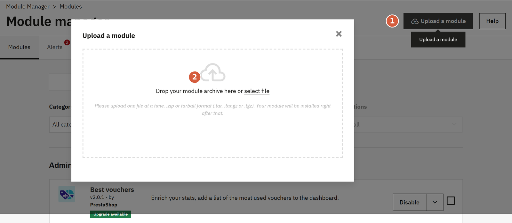

### Step 1 - Upload the module

**Modules > Module Manager > Upload a module** ①, then drop `OSo-MCP-Server-X.Y.Z.zip` ②.

### Step 2 - Open the settings

**Configure**. The settings are in **Shop Parameters > MCP server**.

To update later, upload the new zip the same way. Settings are kept.

## Configuration {#configuration}

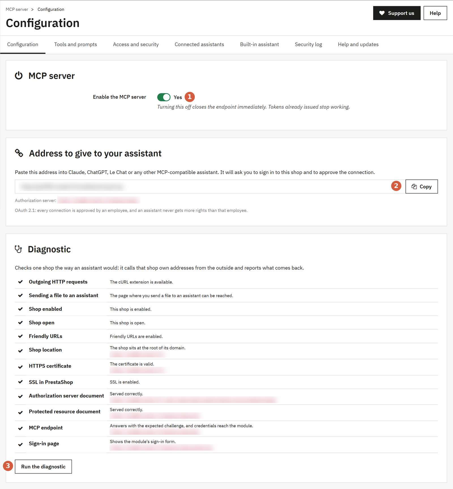

### Step 1 - Enable the server

**Shop Parameters > MCP server > Configuration > Enable the MCP server** ①: **Yes**.

Turning it off cuts every connected assistant at once.

### Step 2 - Copy the address

**Shop Parameters > MCP server > Configuration > Address to give to your assistant > Copy** ②.

### Step 3 - Run the diagnostic {#diagnostic}

**Shop Parameters > MCP server > Configuration > Run the diagnostic** ③.

- tick: OK
- warning: assistants still work, read the message
- cross: no assistant can connect, the message says how to fix it

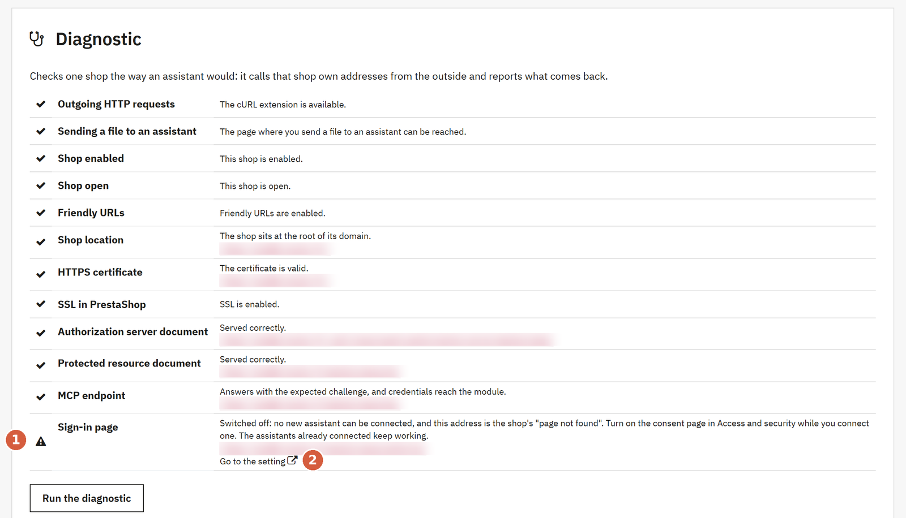

The **Sign-in page** line ① shows a warning while the consent page is off. That is the default. **Go to the setting** ② opens it.

## Access and security {#access}

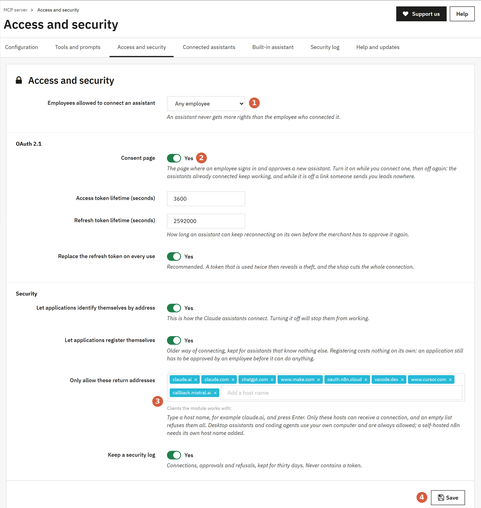

| Setting | Path | What to do |
|---|---|---|
| Employees allowed ① | **Access and security > Employees allowed to connect an assistant** | Leave **Any employee**, or pick a profile |
| Consent page ② | **Access and security > Consent page** | **Yes** only while you connect an assistant, then **No** |
| Return addresses ③ | **Access and security > Only allow these return addresses** | Add a self-hosted n8n here, then **Enter** |
| Save ④ | **Access and security > Save** | |

Leave the other settings as they are.

## Tools and prompts {#tools}

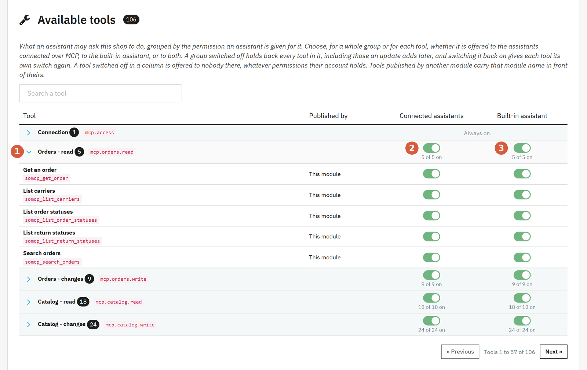

| Item | Path | What it does |
|---|---|---|
| Group ① | **Tools and prompts > Available tools > Orders - read** | Opens the tools of the group |
| Connected assistants ② | **Tools and prompts > Available tools > Connected assistants** | On or off for Claude, ChatGPT... |
| Built-in assistant ③ | **Tools and prompts > Available tools > Built-in assistant** | On or off for the back office chat |

### Compact mode {#compact}

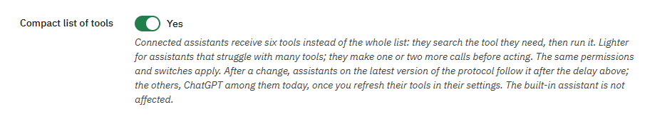

| Item | Path | What it does |
|---|---|---|
| Compact list of tools | **Tools and prompts > Settings > Compact list of tools** | **Yes**: connected assistants get six tools and search the others when they need them. **No**: they get the whole list |

After a change, refresh the tools of the connection in ChatGPT's settings. The built-in assistant is not affected.

## Files {#files}

| Direction | What happens |
|---|---|
| To the shop | The assistant sends the file itself: a photo you attached in ChatGPT, a file it made, or a web address. When it cannot, it gives you a page of your back office to drop the file on |
| From the shop | An invoice, a product photo or a file comes attached to the assistant's answer: it reads it or shows it to you. No link to click |

> [!TIP]
> An assistant that runs code may be blocked from reaching your shop. Allow your shop's domain in its network or allowed domains settings: it then sends files without asking you.

## Employee rights {#rights}

An assistant gets the rights of the employee who connected it. Nothing more.

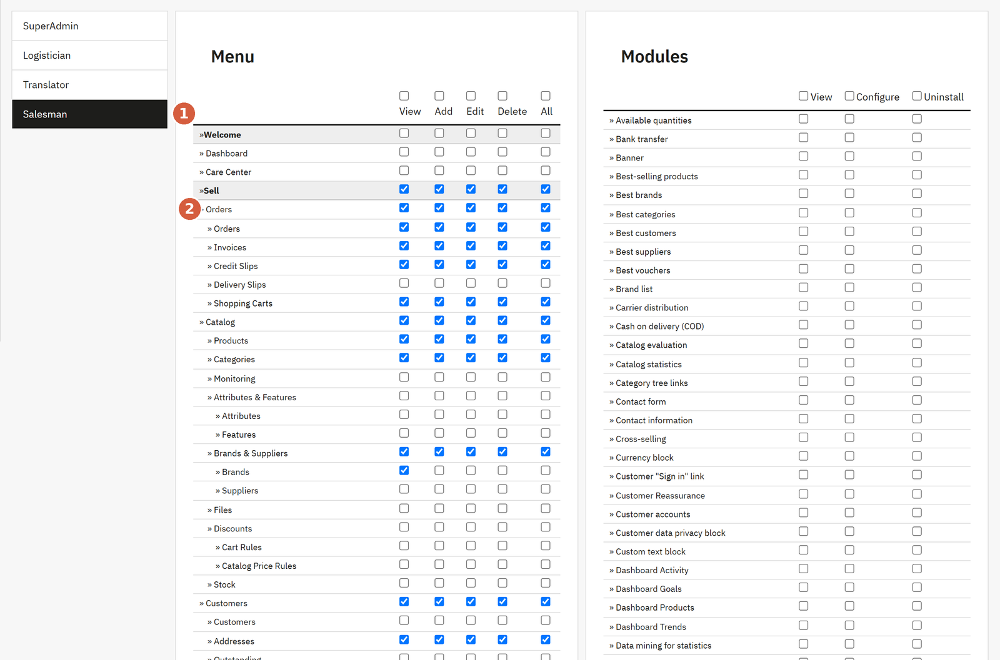

**Team > Permissions** > the profile ① > tick what it may do ②.

## Connect an assistant {#connect}

> [!NOTE]
> First: **Shop Parameters > MCP server > Access and security > Consent page > Yes > Save**. While it is off, the assistant gets a "page not found".

### Step 1 - Add the address to your assistant

Paste the address from **Configuration > Address to give to your assistant**. Where to paste it, in each assistant's own documentation:

| Assistant | Type | Documentation |
|---|---|---|
| Claude (web, desktop, mobile) | Chat | [Custom connectors](https://support.claude.com/en/articles/11175166-get-started-with-custom-connectors-using-remote-mcp) |
| ChatGPT | Chat | [Developer mode and MCP apps](https://help.openai.com/en/articles/12584461) |
| Le Chat (Mistral) | Chat | [Configuring a custom connector](https://help.mistral.ai/en/articles/393572-configuring-a-custom-connector) |
| Dust | Team chat | [Adding an MCP server](https://docs.dust.tt/docs/remote-mcp-server) |
| Claude Code | Command line | [Connect Claude Code to tools via MCP](https://code.claude.com/docs/en/mcp) |
| Codex (OpenAI) | Command line | [Model Context Protocol](https://developers.openai.com/codex/mcp) |
| Gemini CLI (Google) | Command line | [MCP servers with Gemini CLI](https://geminicli.com/docs/tools/mcp-server/) |
| GitHub Copilot CLI | Command line | [Adding MCP servers](https://docs.github.com/en/copilot/how-tos/copilot-cli/customize-copilot/add-mcp-servers) |
| Cursor | Code editor | [Model Context Protocol](https://cursor.com/docs/context/mcp) |
| VS Code (GitHub Copilot) | Code editor | [Add MCP servers in VS Code](https://code.visualstudio.com/docs/copilot/customization/mcp-servers) |
| Windsurf (Devin Desktop) | Code editor | [MCP servers](https://docs.devin.ai/desktop/devin-local/customizations#mcp-servers) |
| Zed | Code editor | [Model Context Protocol](https://zed.dev/docs/ai/mcp) |
| n8n Cloud | Automation | [MCP Client node](https://docs.n8n.io/integrations/builtin/core-nodes/n8n-nodes-langchain.mcpclient/) |
| n8n self-hosted | Automation | [MCP Client node](https://docs.n8n.io/integrations/builtin/core-nodes/n8n-nodes-langchain.mcpclient/) |
| Make | Automation | [MCP Client](https://apps.make.com/c5ZhYquO55e90hoCJ0rzt) |

### Step 2 - Sign in

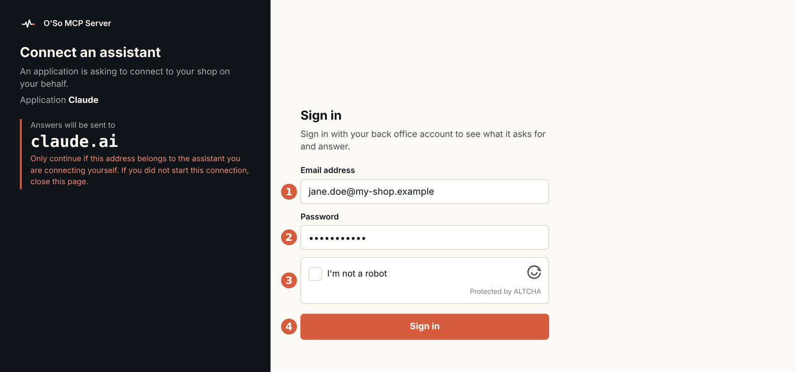

Check **Answers will be sent to** first: it must be your assistant (`claude.ai`, `chatgpt.com`...).

E-mail ①, password ②, **I'm not a robot** ③, **Sign in** ④.

> [!TIP]
> 5 failures from one address, or 10 on one account: blocked 15 minutes.

### Step 3 - Type the code

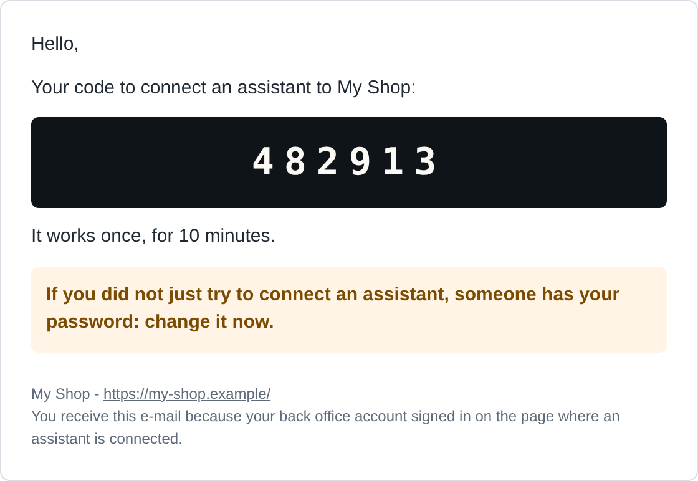

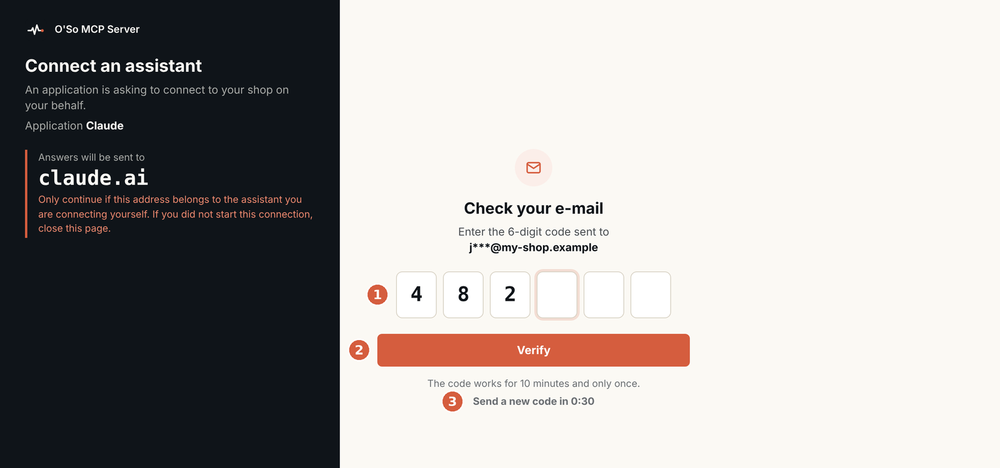

Code from the e-mail ①, **Verify** ②. No e-mail: check the spam, then **Send a new code** ③ (after 30 s, then 45 s, 3 codes max).

### Step 4 - Allow

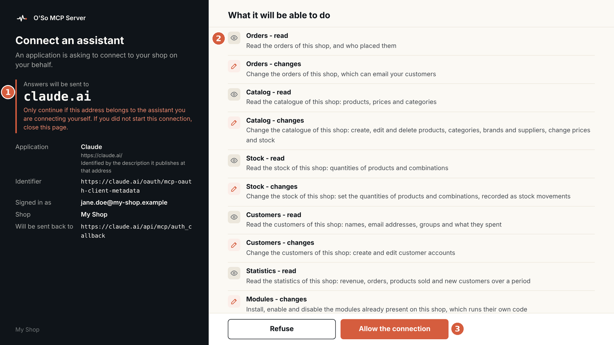

Check the address ①, read the permissions ②, **Allow the connection** ③.

An e-mail confirms the connection:

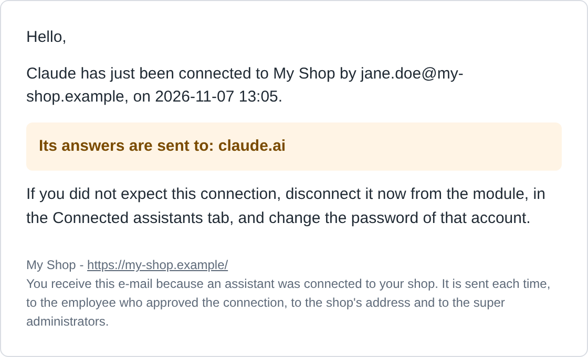

### Step 5 - Close the page again

**Shop Parameters > MCP server > Access and security > Consent page > No > Save**. The assistant keeps working.

## Built-in assistant {#builtin}

A chat at the top right of every back office page.

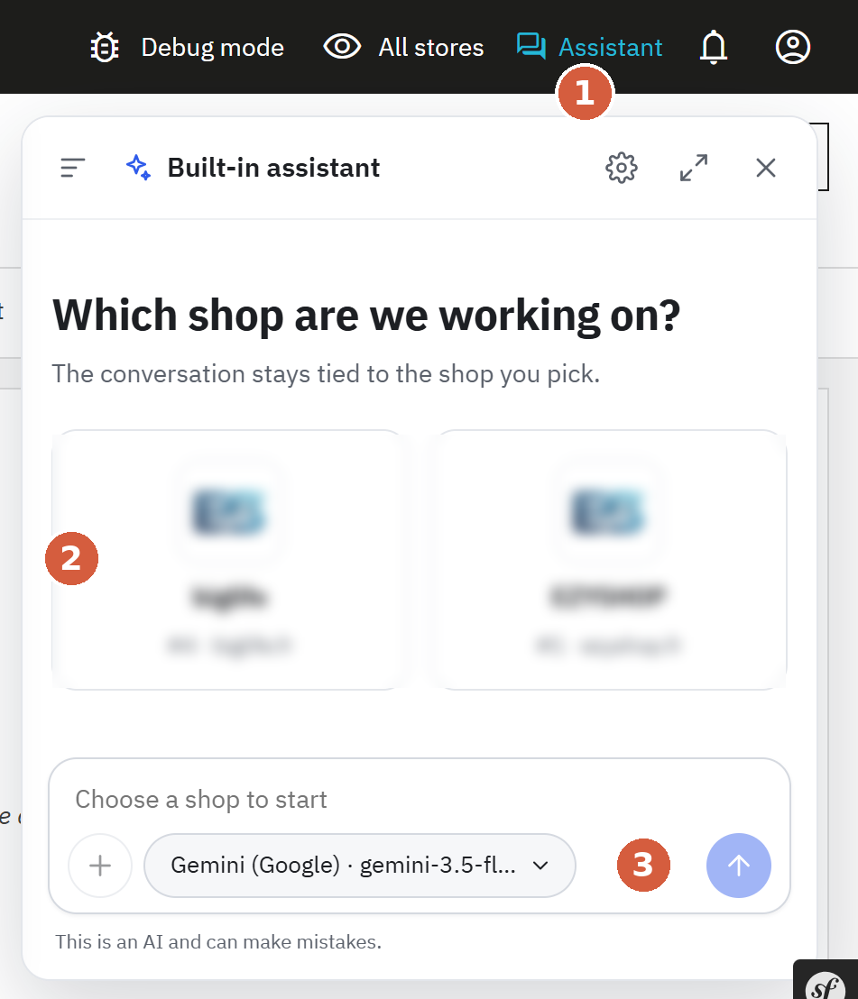

**Assistant** ①, pick the shop ②, type your question and send ③.

> [!WARNING]
> In development: may change or stop working, consumption can be high.

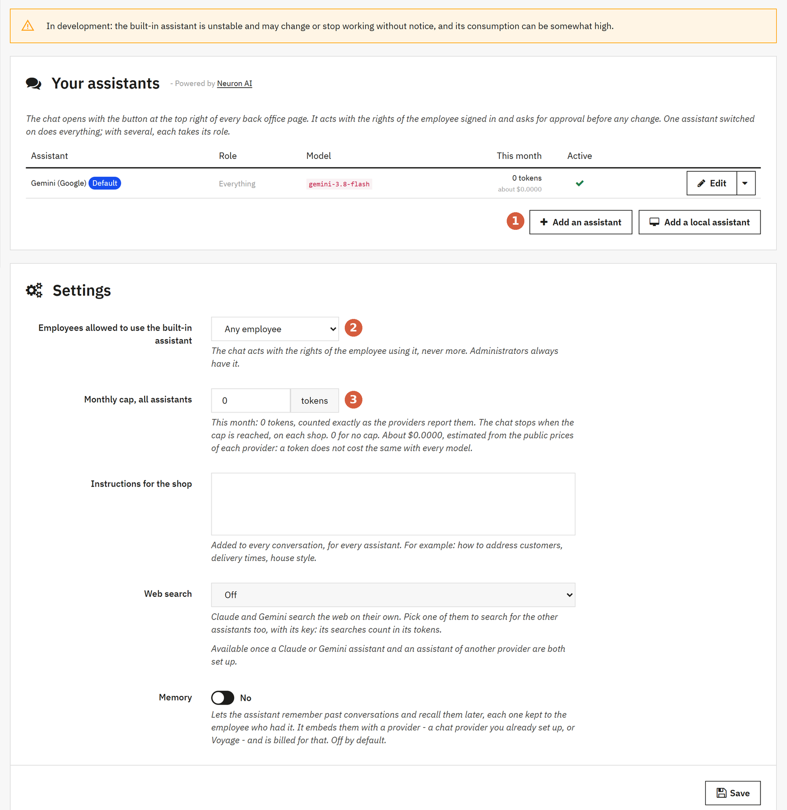

| Item | Path | What to do |
|---|---|---|
| Add an assistant ① | **Built-in assistant > Your assistants > Add an assistant** | Pick a provider, paste your API key |
| Employees allowed ② | **Built-in assistant > Settings > Employees allowed to use the built-in assistant** | Leave, or pick a profile |
| Monthly cap ③ | **Built-in assistant > Settings > Monthly cap, all assistants** | Tokens per month, 0 = no cap |

Where to get an API key:

| Provider | API key |
|---|---|
| Claude (Anthropic) | [console.anthropic.com/settings/keys](https://console.anthropic.com/settings/keys) |
| ChatGPT (OpenAI) | [platform.openai.com/api-keys](https://platform.openai.com/api-keys) |
| Gemini (Google) | [aistudio.google.com/apikey](https://aistudio.google.com/apikey) |
| Mistral | [console.mistral.ai/api-keys](https://console.mistral.ai/api-keys) |
| DeepSeek | [platform.deepseek.com/api_keys](https://platform.deepseek.com/api_keys) |
| Grok (xAI) | [console.x.ai](https://console.x.ai) |
| Cohere | [dashboard.cohere.com/api-keys](https://dashboard.cohere.com/api-keys) |
| Ollama, LM Studio (on your computer) | No key: **Add a local assistant**, with [O'So AI Relay](https://github.com/novalo-dev/Somcp-Relay) |

## Troubleshooting {#troubleshooting}

| Problem | Fix |
|---|---|
| The assistant gets "page not found" | **Access and security > Consent page > Yes** |
| "Too many attempts" | Wait 15 minutes |
| No code by e-mail | Spam folder, then **Advanced Parameters > E-mail**, then **Security log** (`code_mail_failed`) |
| Connection fails | **Configuration > Run the diagnostic** |
| Self-hosted n8n refused | **Access and security > Only allow these return addresses**: add its host name |
| Assistant stopped after 30 days unused | Connect it again |

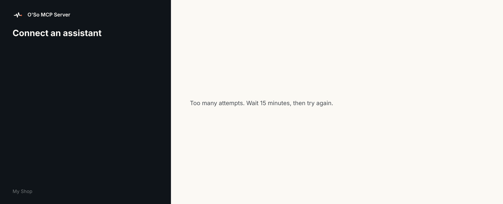

## Updates and support {#support}

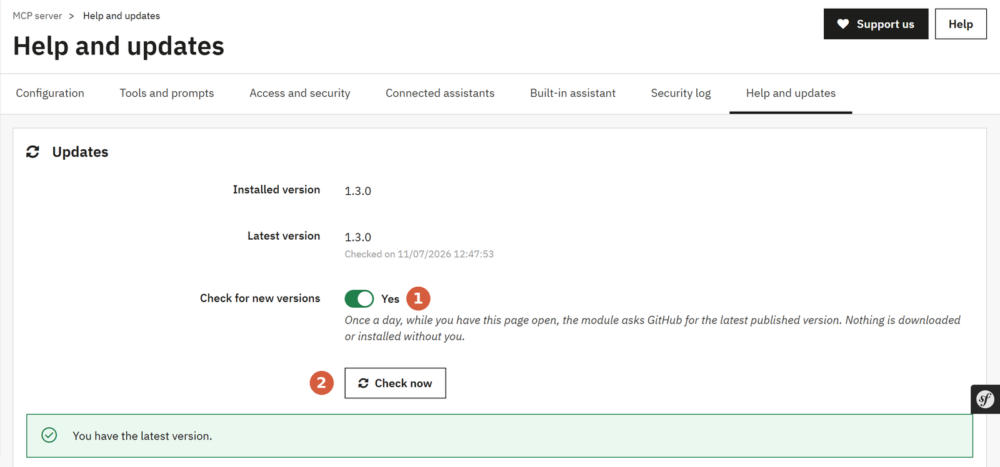

| Item | Path | What to do |
|---|---|---|
| Check for new versions ① | **Help and updates > Updates > Check for new versions** | **Yes**: the module asks GitHub once a day |
| Check now ② | **Help and updates > Updates > Check now** | When a version is out: **Download the zip**, then [Installation](#installation) |

Uninstalling deletes every connected assistant and token.

Questions: github.com/novalo-dev/Prestashop-MCP-Server/issues - novalo.fr
